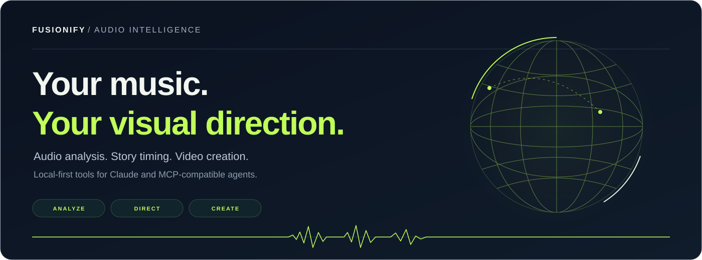
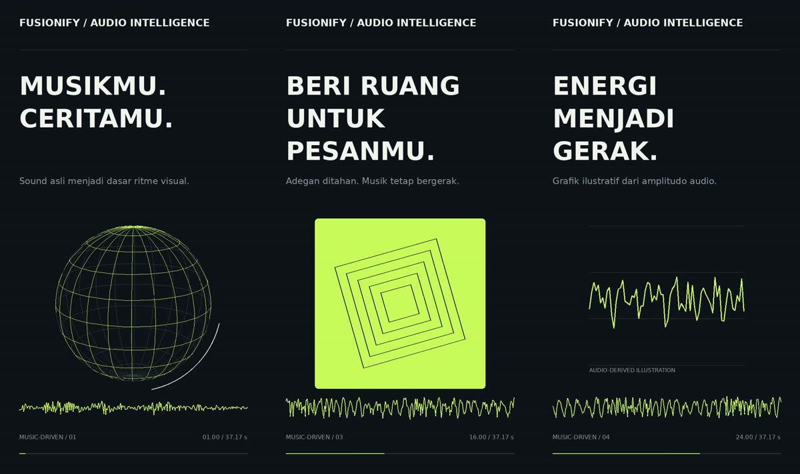

<p align="center">
  
</p>

<p align="center">
  <strong>Turn real audio into deliberate visual edits.</strong><br />
  Music analysis, creative direction, voice review, and video rendering for AI agents.
</p>

<p align="center">
  <a href="https://github.com/FUSIONIFY-ID/Fusionify_Audio_Intelligence/actions/workflows/test.yml"></a>
  <a href="pyproject.toml"></a>
  <a href="#quick-start"></a>
  <a href="docs/tools.md"></a>
</p>

<p align="center">
  <a href="#quick-start"><strong>Get started</strong></a> ·
  <a href="#connect-your-agent">Connect your agent</a> ·
  <a href="#see-the-output">See the output</a> ·
  <a href="#documentation">Documentation</a> ·
  <a href="https://github.com/FUSIONIFY-ID/Fusionify_Audio_Intelligence/issues">Report an issue</a>
</p>

---

## Let the soundtrack shape the edit

A beat can trigger a small reaction. A scene needs enough time to say something.

Fusionify Audio Intelligence gives Claude and MCP-compatible agents a practical way to work with **actual audio files**: inspect the sound, review timing, build a visual story, preview a chosen moment, and render the full project. Use it for JJ, remix, breakbeat, product promos, cinematic edits, or voice-led content.

**Local processing by default · Full soundtrack by default · Timing you can inspect and revise**

The current toolkit includes **37 MCP tools**, **3 companion skills**, a Python CLI, and an authenticated creator console. The core workflow runs without a paid model API.

**New in v0.7:** [review cut timing against the music](docs/sync-review.md). Inspect signed millisecond offsets, renderer frame rounding, marker provenance and suggested listening excerpts before revising a scene. The review preserves intentional story cues and does not auto-snap cuts.

## See the output



These are frames from a full-length video rendered by the project service. Globe, orbit, spectrum, and chart scenes use continuous motion and the original soundtrack. The chart visualizes audio amplitude; real business data is supplied separately.

## What you can build

| Capability | What it gives your agent |
| --- | --- |
| **Understand the timing** | Duration, pulse estimates, onset candidates, energy, waveform, levels, and spectral measurements from the selected file. |
| **Review the rhythm** | Full-length original/click previews, editable markers, tap-tempo estimates, and explicit BPM regions with source-time anchors. |
| **Direct the story** | A content brief, readable section holds, small beat reactions, locked cues, and checks for structural editing problems. |
| **Create the visuals** | Native motion graphics or montages from your photos and clips, with fixed cut, zoom, pan, and shake effects. |
| **Review voice and text** | Pitch/activity contours, optional local transcription, script differences, listening-review flags, and timed subtitle exports. |
| **Revise and deliver** | Saved project revisions, targeted previews, cancellable jobs, full renders, and downloadable artifacts. |

**Output:** MP4 video in **9:16, 16:9, or 1:1**, at a short-side resolution of **480, 720, or 1080 pixels**. Exports include project JSON/CSV, waveform SVG, MP3 timing previews, and SRT/VTT subtitles.

Measured timing remains an estimate. Review markers by listening, and use corrections where needed. Voice pitch in mixed music can follow an instrument; transcript agreement alone cannot establish correct pronunciation or intonation.

## Quick start

### 1. Install the workspace

Have **Python 3.11+**, [uv](https://docs.astral.sh/uv/), **FFmpeg**, and **ffprobe** on your machine.

```bash
git clone https://github.com/FUSIONIFY-ID/Fusionify_Audio_Intelligence.git
cd Fusionify_Audio_Intelligence
uv sync --frozen
uv run --frozen fusionify-audio doctor
```

### 2. Choose your media folder

On macOS or Linux:

```bash
mkdir -p media
export FAI_MEDIA_ROOT="$PWD/media"
export FAI_STATE_ROOT="$PWD/state"
```

<details>
<summary><strong>Windows PowerShell</strong></summary>

```powershell
New-Item -ItemType Directory -Force media | Out-Null
$env:FAI_MEDIA_ROOT = (Resolve-Path .\media).Path
$env:FAI_STATE_ROOT = Join-Path (Get-Location).Path 'state'
```

</details>

Place your soundtrack in that folder, for example `media/track.mp3`. Audio inputs include MP3, WAV, FLAC, OGG, and M4A; supported video inputs include MP4 and MOV.

### 3. Analyze, save, and render

```bash
uv run --frozen fusionify-audio analyze "track.mp3"
uv run --frozen fusionify-audio profile ANALYSIS_ID
uv run --frozen fusionify-audio create-project ANALYSIS_ID
uv run --frozen fusionify-audio render-project PROJECT_ID
```

Replace `ANALYSIS_ID` and `PROJECT_ID` with the IDs returned by the preceding commands. A default project uses the full remaining soundtrack, within the input limit. CLI render commands wait and return the resulting artifact path.

Want your agent to direct the edit? Connect it to the same workspace below.

## Connect your agent

### Claude Code plugin

Set the media/state environment variables in the shell that launches Claude, then install:

```text
/plugin marketplace add FUSIONIFY-ID/Fusionify_Audio_Intelligence
/plugin install fusionify-audio-intelligence@fusionify-audio
```

For a local checkout:

```bash
claude --plugin-dir /absolute/path/to/Fusionify_Audio_Intelligence
```

| Included skill | Its role |
| --- | --- |
| **audio-intelligence** | Inspect actual audio, review/correct rhythm, and guide voice/script checks. |
| **music-driven-video** | Translate music and the content brief into a revisable visual story. |
| **workspace-setup** | Configure clients, resolve inaccessible media, and recover workspace state. |

### Native plugins and code editors

Plugin bundle **v0.7.1** includes **Agent Plugins 1.0.0** packaging for compatible editors, a **Cursor-native manifest**, and the existing Claude plugin. These bundles combine skills with an MCP launcher. See [plugin, marketplace, and skills.sh installation](docs/distribution.md) for the full routes. See [security audit evidence and limitations](docs/security-audits.md) for source-content isolation and external audit status.

| Client | Configuration route | Current project support |
| --- | --- | --- |
| **Claude Desktop** | Local `mcpServers` entry | Configuration generator included. |
| **Cursor** | Native plugin / Agent Plugins | Source manifests and repository marketplace included; public review remains separate. |
| **Kiro** | GitHub/folder power import | Agent Plugins package included. |
| **VS Code + Copilot** | Agent Customizations → plugin from source | Portable plugin and custom-marketplace route in compatible versions. |
| **Remote MCP clients** | Authenticated HTTPS `/mcp` endpoint | Self-hosted HTTP server; see [deployment](docs/deployment.md). |

Install the three skills separately with the skills CLI:

```bash
npx skills add FUSIONIFY-ID/Fusionify_Audio_Intelligence
```

A skills-only install supplies instructions. Connect the MCP runtime to process music or render videos. Native plugins need `uvx`, Git, FFmpeg, and an existing `FAI_MEDIA_ROOT` folder; the first launch fetches the documented pinned engine. Source packages are separate from curated public marketplace listings.

Generate a local Claude Desktop entry with real absolute paths:

```bash
python scripts/configure_client.py \
  --client claude-desktop \
  --media-root /absolute/path/to/media \
  --state-root /absolute/path/to/state
```

The generator prints JSON. Add `--write /path/to/config.json` to merge a chosen file with a backup. It preserves other server entries; replacing an existing Fusionify entry requires `--replace`. Use `--uv-command /absolute/path/to/uv` if the client cannot find `uv`.

MCP stdio/HTTP and the Claude plugin manifest are tested. Live GUI sessions in these clients remain separate integration checks. Companion skills follow the client's own installation mechanism.

### Browser console and remote access

The console provides uploads, rhythm review, project controls, previews, and downloads.

```bash
uv run --frozen fusionify-audio generate-token
# Store the generated value in FAI_API_TOKEN in your local/server environment.
export FAI_PUBLIC_BASE_URL="http://127.0.0.1:8000"
uv run --frozen fusionify-audio serve-http
```

Open **http://127.0.0.1:8000/** and enter your workspace token. The console keeps the token in page memory. Uploading makes a chat attachment available to the server; attachments are not transferred automatically.

For remote use, deploy behind HTTPS and configure the client with your actual `/mcp` URL and `Authorization: Bearer …` header. Client support for fixed authorization headers varies. The repository provides deployment code, rather than a public hosted endpoint. Follow the [deployment guide](docs/deployment.md) for client authentication and hosting.

Use one process per state directory. A shared HTTP server is the route for multiple clients using the same workspace.

## A workflow worth keeping

| Step | What happens |
| --- | --- |
| **Analyze** | Resolve the exact soundtrack and inspect its duration, waveform, and timing estimates. |
| **Direct** | Use the content brief to choose story blocks and readable holds; keep micro reactions separate from major cuts. |
| **Review** | Listen to timing markers, inspect a preview, and lock important source-time cues. |
| **Revise** | Adjust a saved project against its current revision, preserving the choices you want to keep. |
| **Render** | Export the full saved project and any matching subtitle or timeline sidecars. |

> Pakai seluruh durasi musik ini untuk video produk vertikal. Buka dengan globe, beri ruang untuk pesannya, lalu tutup dengan nama brand. Gerak kecil mengikuti ritme, shake secukupnya. Buat preview dulu supaya timing bisa diperiksa.

See [editing workflows](docs/workflows.md) for native story options, exact cue placement, targeted previews, source-synchronized footage, and multi-region tempo maps. See [all 37 tools](docs/tools.md) for the MCP tool map and workspace limits.

## Optional audio intelligence

<details>
<summary><strong>Local speech transcription, script checking, and subtitles</strong></summary>

Voice delivery measurements work in the base installation. Automatic transcription additionally needs the `speech` extra and a compatible, complete local Whisper model directory:

```bash
uv sync --frozen --extra speech
export FAI_WHISPER_MODEL_DIR="/absolute/path/to/converted-whisper-model"
uv run --frozen --extra speech fusionify-audio serve
```

Keep `--extra speech` in the actual client launch command. Model weights are prepared separately; tools do not download them. Imported transcripts stay explicitly unverified against audio.

v0.6.1 passes validated PCM directly into the local backend, handles exact digital silence with explicit provenance, and flags estimated words for listening review. A real local-model smoke run covers synthetic English narration and music beds; it does not establish Indonesian, singing, or real remix accuracy.

[Voice setup and examples](docs/voice-review.md) · [Recorded verification results](docs/verification.md#real-local-model-check-v061)

</details>

<details>
<summary><strong>Opt-in music interpretation with Gemini</strong></summary>

The optional Gemini adapter can provide mood, texture, and visual suggestions. It requires operator configuration, explicit user agreement to external audio processing, and may incur provider charges. DSP analysis never invokes it silently. Provider descriptions are interpretations; timing still comes from measured or user-corrected markers.

[Configure the optional provider](docs/deployment.md#optional-gemini-interpretation)

</details>

## Documentation

| Guide | Go here for |
| --- | --- |
| [Editing workflows](docs/workflows.md) | Story direction, timing corrections, cue locks, previews, and footage controls. |
| [MCP tool reference](docs/tools.md) | The complete tool map, output behavior, and operational limits. |
| [Voice and script review](docs/voice-review.md) | Local ASR, transcript provenance, script comparisons, and subtitle timing. |
| [Editor setup](docs/editor-setup.md) | Generate client-specific configs and verify a full installed-package render. |
| [Plugins and skills.sh](docs/distribution.md) | Native packages, source installs, custom marketplaces, and publication status. |
| [Deployment](docs/deployment.md) | Docker, HTTPS, tokens, uploads, URL imports, and remote clients. |
| [Verification](docs/verification.md) | What was tested, observed model errors, browser checks, and remaining gaps. |
| [Specification](SPEC.md) | Product intent and implementation contracts. |

## Development and verification

The current backend suite has **61 tests**. Separate checks cover real MCP handshakes over stdio and TCP HTTP, browser workflows, strict plugin validation, and the container build.

```bash
uv run --frozen python -m unittest discover -s tests -v
uv run --frozen python tests/mcp_smoke.py
uv run --frozen python tests/http_mcp_smoke.py
```

Browser checks, on a host that permits Chromium:

```bash
npm ci
npx playwright install --with-deps chromium
npm run test:e2e
```

Optional provider contracts use mocks. The opt-in [local-model smoke script](tests/local_speech_smoke.py) runs actual inference using a separately prepared model. Synthetic fixtures keep the repository tests independent of commercial soundtracks. Full test scope and practical limits are recorded in [verification notes](docs/verification.md).

For bug reports, include your client, runtime versions, source format/duration, steps to reproduce, and expected behavior. Small synthetic fixtures make timing problems easier to investigate.

---

<p align="center">
  Built by <a href="https://github.com/FUSIONIFY-ID"><strong>FUSIONIFY</strong></a>.<br />
  <sub>Start with the sound. Give the story a direction.</sub>
</p>
